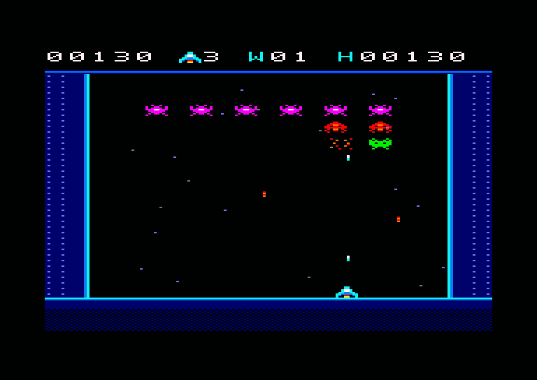
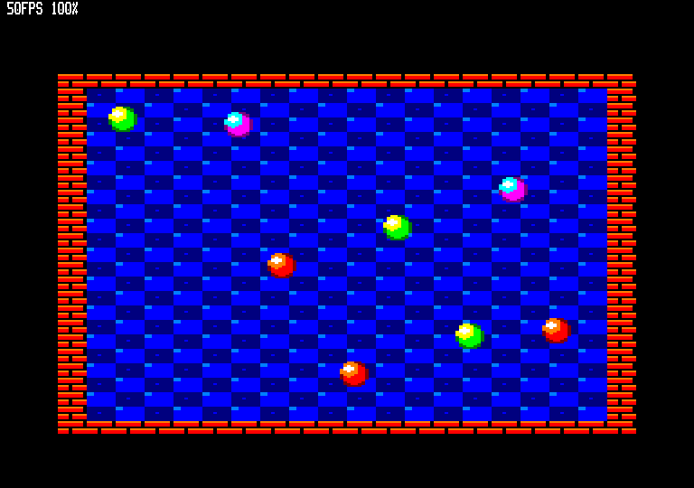

# CPCBuild

CPCBuild is an Amstrad CPC toolchain: a language, a compiler, a game library, asset tools and a VS Code editor to write CPC and CPC Plus programs in.

- **CPC BASIC** is the language: Locomotive BASIC 1.1 as you know it, with typed `SUB`s and `FUNCTION`s, arrays, inline Z80, includes and the other features that make compiled games fast.
- **`cpcbas`** is its compiler, in its own repository, [carcharo/cpcbas](https://github.com/carcharo/cpcbas). It makes `.bin`, `.dsk` and `.cpr` files for the CPC 464, 664, 6128 and the Plus range.
- **CPCBuild** (this repository) is the toolchain around it: the `cpcbuild` game library's docs and tools, asset converters, examples, two games, the tests, and the VS Code extensions.
- **CPC Game Studio** is the product: the VS Code front end of CPCBuild. It has project templates, palette, sprite, tile and sound editors, a music tracker, an image importer, build and run, and an emulator tab with a debugger. It is two extensions, `cpcbuild-studio` and `cpcbuild-emu`, in `vscode/`.

CPC BASIC is compatible in spirit with Locomotive BASIC 1.1; its modern features and parts of its code generator are derived from Boriel BASIC 1.19 (AGPL-3.0); the runtime library is MIT. See [Licence](#licence).

## Status

Version 0.2.0: the two VS Code extensions and one SDK `.zip` for Windows, macOS and Linux, on the
[Releases page](https://github.com/carcharo/cpcbuild/releases). What changed since 0.1.x is in the
[changelog](CHANGELOG.md).

**Compiler and runtime** (in [cpcbas](https://github.com/carcharo/cpcbas))
- Integers, reals, strings, arrays, `DATA`/`READ`, `SELECT CASE`, `EVERY`/`AFTER`, error handling, the Locomotive graphics, text, keyboard, sound and file statements.
- Firmware mode (the default) goes through the firmware for text, graphics, sound and files, with interrupts always on.
- Bare-metal mode (`-D CPC_BAREMETAL`) never calls the firmware: the runtime boots the machine and does its own
  text, keyboard, sound and graphics. It also starts from a cold machine, which is how cartridges run.

**The `cpcbuild` library** (MIT; [docs/library.md](docs/library.md))
- Screen addressing, double buffering, sprites (plain and masked), tiles and tile maps, fills, keyboard matrix
  scan, palettes, extra RAM banks on the 6128.
- Sound: AY register access, the Arkos Tracker 3 music player, sound effects, an opt-in game mode.
- CPC Plus: 16 hardware sprites, the 12-bit palette, soft scroll and split screen, raster interrupts (bare-metal
  only), DMA sound, cartridges (`.cpr`).

**Tools**
- **CPC Game Studio** for VS Code: project templates, build and run, CPC BASIC editing with the compiler's errors as you type,
  palette, sprite and tile editors, an image importer, a Tiled map viewer, a sound-effects editor, a music tracker,
  music conversion, and an emulator tab (CPCEC compiled to WebAssembly) with a debugger.
- Command-line asset tools: `img2cpc.py`, `tmx2bas.py`, `aks2bas.py` ([art guide](docs/art-guide.md)).
- Tests: language conformance (in the cpcbas repository) and screenshot comparisons in firmware and bare-metal modes, on a
  headless emulator built on floooh/chips (464, 6128) and on Caprice32 and CPCEC (6128 Plus), all in CI.

**Games**
- **Lamplighter**, a flip-screen platformer, and a [tutorial](docs/tutorial/README.md) that builds it chapter by
  chapter in plain BASIC, measures it, then brings in six assembly routines. Builds for the CPC 464 and 6128 and the CPC Plus.
- **Starfall**, a single-screen shooter for the CPC 6128 and 464 (firmware and bare-metal builds) and a CPC Plus
  cartridge with a multiplexed hardware-sprite formation. It is built by its scripts in a checkout, not from Studio
  ([games/shooter/README.md](games/shooter/README.md)).

**Supported models:** Amstrad CPC 464, 664 and 6128, and the CPC Plus range (6128 Plus; GX4000 cartridges).
The ZX Spectrum target of 0.1.x is gone; see below.

## Install

The current version is 0.2.0. Everything is on the
[Releases page](https://github.com/carcharo/cpcbuild/releases). You need [VS Code](https://code.visualstudio.com/)
(1.90 or later; on Linux with an ARM processor, see the note for Linux below). You do not need Python or Node.js:
the compiler runs inside Studio.

Pick one route.

### Route A: the two extensions

1. From the Releases page, download `cpcbuild-studio-0.2.0.vsix` and `cpcbuild-emu-0.2.0.vsix`.
2. In VS Code, open the Command Palette (Ctrl+Shift+P; Cmd+Shift+P on macOS) and run
   **Extensions: Install from VSIX...**. Do this once for each file.
3. Run **Welcome: Open Walkthrough...** and choose **Get started with CPC Game Studio**.
4. The walkthrough's steps create a project from a template, then build and run it. When VS Code asks
   whether you trust the authors of the project folder, choose **Trust**: Studio cannot build in a folder VS Code
   does not trust. You can skip **Install Emulator**: it is for people who installed Studio without the emulator
   extension.
5. Only if you want to convert songs from Arkos Tracker: run **CPC Game Studio: Download Tools**. Studio downloads the Arkos
   Tracker 3.7 command-line tools and checks them against a known checksum.

Run **CPC Game Studio: Check Environment** at any time to see what Studio found and what to fix.

### Route B: the SDK folder

The SDK is one folder for every platform: the compiler as one file (`bin/cpcbas.mjs`), the library, the docs, the examples,
the sources of the games Lamplighter and Starfall, and both `.vsix` files. Download `cpcbuild-sdk-0.2.0.zip`, unpack it
anywhere, install the two `.vsix` files from inside it as in route A, and read `README-FIRST.txt`.
Studio compiles by itself and needs nothing from the folder; the command line (`node bin/cpcbas.mjs`) needs
[Node.js](https://nodejs.org/) 22 or newer.

### Notes for each system

- **macOS and Windows.** There is no program in the SDK to sign: `bin/cpcbas.mjs` is a script that Node runs, and VS Code
  installs the `.vsix` files. Unpack the zip with Finder or **Extract All** to a folder on a local drive, such as
  `C:\cpcbuild-sdk`.
- **Windows in a virtual machine** (Parallels, for example): folders shared from the host appear as network paths
  (`\\Mac\...`), and VS Code refuses to open files there ("UNC host ... access is not allowed"). Copy the `.vsix`
  files and keep your projects on the virtual machine's own drive.
- **Windows on ARM.** The Arkos tools that Studio downloads run under Windows' x64 emulation.
- **Linux.** On an ARM computer (a Raspberry Pi, an ARM laptop or virtual machine) VS Code's website offers the x64
  `.deb` by default, which will not install: choose the **Arm64** `.deb` and install it in a terminal with
  `sudo apt install ./code_*_arm64.deb` (Ubuntu's App Center can hang on downloaded `.deb` files).

### Coming from 0.1.x

CPCBuild 0.1.x compiled Boriel BASIC with a fork of that compiler. A 0.1.x project needs one conversion step:

- In Studio, open the project and run **CPC Game Studio: Convert Project to CPC BASIC**. It shows a report of what it
  would change and writes only after you say yes.
- On the command line, `node bin/cpcbas.mjs migrate --help` (or `cpcbas migrate` from a cpcbas checkout) does the same
  translation.
- The Spectrum targets are gone; Convert offers to remove them from `cpcbuild.json`.
- The 0.1.2 release, the `v0.1.2` tag and the compiler fork stay available for old projects.

[docs/migrating-from-0.1.md](docs/migrating-from-0.1.md) has the details.

## Screenshots

**Starfall:** a single-screen shooter for the CPC.



See [games/shooter/README.md](games/shooter/README.md) for how to play it and how to build the CPC builds from a checkout.

**bounce.bas demo:** A tiled background (8×8 mode-0 tiles, 16-colour palette) with eight masked sprites bouncing, double-buffered, at up to 25 updates per second in game mode (a new frame every other 50 Hz screen refresh).



Build the demo yourself from a checkout: `make run PROG=examples/bounce.bas` (see [Developing CPCBuild](#developing-cpcbuild))

## Developing CPCBuild

This section is for working on CPCBuild itself. To use it, see [Install](#install).

### Prerequisites

- macOS or Linux. CI runs the `make` targets on Ubuntu; Windows is untested (WSL may work)
- Python 3 + Pillow (`pip install Pillow`), for the Python asset tools in `tools/` and the test scripts
- Node.js 22 or newer, and a built cpcbas checkout as `../cpcbas` (or `CPCBAS=path`) at the commit `cpcbas.json` pins:
  `npm ci && npm run build` in that checkout. The `make` targets compile with it.
- Caprice32 built from source in `../caprice32`, or with `make cap32` (used for `make run` and `make test`). It needs
  SDL2, FreeType and libpng: on macOS `brew install sdl2 freetype libpng pkg-config`; on Debian/Ubuntu
  `sudo apt install g++ make pkg-config libsdl2-dev libfreetype6-dev zlib1g-dev libpng-dev`
- A C compiler for chipsrun, the headless runner used by `make test-chips` and CI (no other dependencies; `make chips` fetches and builds it)

### Commands

```bash
# Interactive: build and run a program in Caprice32 (keep its window visible:
# macOS throttles a hidden Caprice32, and its sound then stutters)
make run PROG=examples/bounce.bas

# Headless screenshot (PNG output in build/shots/; the program has to
# take its own screenshot: -D SHOT=n does it after n updates)
make shot PROG=examples/bounce.bas DEFS="-D NOSOUND -D SHOT=40"

# Unit tests (img2cpc, tmx2bas and the other tools)
make unit

# Conformance tests (Caprice32, all models)
make test-all

# CI runner (headless, chips emulator, 464 and 6128)
make test-chips

# Benchmark (bounce.bas, measures updates/sec)
make bench
```

`make help` lists every target.

### Measured speeds (bounce.bas, 8 balls, CPC 6128, chips, `make bench`)

Normal mode: silent 20.0 updates/sec, with wall blips 18.2, with blips and music 18.2.
Game mode: silent 25.0, with effects 25.0, with effects and music 25.0 (CPU available elsewhere).

Build switches: `-D BALLS=n` (1–8, default 8), `-D NOMUSIC` (effects only), `-D NOSFX` (music only),
`-D NOSOUND` (silent), `-D GAMEMODE` (game mode on), `-D FWSOUND` (firmware sound), `-D BENCH`,
`-D SHOT=n` (screenshot after n updates). Pass them to `make` with `DEFS="-D NOSOUND"`.

## Repository layout

```
docs/                     # Documentation: library reference, tutorial, art guide, notes for 0.1.x projects
examples/                 # Demo programs (bounce.bas, finetiles.bas, plusdemo.bas)
examples/assets/          # PNG and TMX sources for bounce.bas (built by make assets)
games/                    # Lamplighter and Starfall
tests/                    # Test suite
  plus/                   # CPC Plus smoke tests
  screens/                # Screenshot regression tests
  stress/                 # Interrupt load and timing verification
  tools/                  # Unit tests for the tools
bench/                    # Benchmark suite and measurements
tools/                    # Asset pipeline and emulator runners
  img2cpc.py              # PNG to mode 0/1/2 sprites, tiles, maps, palettes
  tmx2bas.py              # Tiled .tmx map to TileMap bytes
  aks2bas.py              # Arkos Tracker songs and effects to includes
  build_assets.sh         # Rebuild all assets
  cpcrun.py               # Compile and run a program headlessly (Caprice32, or chips with --emu chips)
  chipsrun/               # Headless chips emulator runner (CI)
vscode/                   # CPC Game Studio: cpcbuild-studio and cpcbuild-emu
packaging/                # The SDK archive
Makefile                  # Build targets (run, shot, test, bench, ci, etc.)
cpcbas.json               # The cpcbas commit this repository builds with
```

The runtime library, the language reference and the conformance suite are in the [cpcbas](https://github.com/carcharo/cpcbas) repository.

## Documentation

- **[Library reference](docs/library.md)** — API for sprites, tiles, keyboard, palette, sound, and [CPC Plus hardware](docs/library.md#10-cpc-plus-cpcplus)
- **[Language reference](https://github.com/carcharo/cpcbas/blob/main/docs/keywords.md)** — every statement and function of CPC BASIC (`docs/keywords.md` in the SDK)
- **[Tutorial](docs/tutorial/README.md)** — build a complete game (Lamplighter) step by step
- **[Art guide](docs/art-guide.md)** — drawing sprites and tiles and getting them into a project
- **[Coming from 0.1.x](docs/migrating-from-0.1.md)** — converting a Boriel BASIC project
- **[Changelog](CHANGELOG.md)**

## Emulator roles

| Emulator | Role | Notes |
|----------|------|-------|
| **Caprice32** | Day-to-day development and interactive testing (464/664/6128 all models, Plus phases) | Master reference for firmware behaviour |
| **chips (floooh)** | Automated CI reference on 464 and 6128 (chipsrun headless runner) | Cycle-stepped Z80, deterministic; runs conformance suite ~15x real-time |
| **Retro Virtual Machine** | Optional manual spot-check (Plus, or when emulators disagree) | Not required |

## Licence

This repository (the tools, the examples, the games, the docs) is licensed under the MIT License (see [LICENSE](LICENSE)).
The cpcbuild library routines (sprites, tiles, keyboard, etc.) are written clean-room and licensed MIT; they live in
the cpcbas repository's `lib/`, as does the Arkos Tracker 3.7 music player, MIT, copyright (c) 2016-2025 Julien Nevo
(`lib/music/LICENSE.arkos` there).

The `cpcbas` compiler is AGPL-3.0-or-later. CPC BASIC is compatible in spirit with Locomotive BASIC 1.1; its modern
features and parts of its code generator are derived from Boriel BASIC 1.19 (AGPL-3.0); the runtime library is MIT. The
credits are in cpcbas's `NOTICE`. The CPC Game Studio `.vsix` bundles the compiler, so it is distributed under the
AGPL-3.0-or-later as a combined work (the Studio's own sources stay MIT); the CPC Game Studio Emulator extension is
GPL-3.0-or-later and built on CPCEC by Cesar Nicolas-Gonzalez. The SDK's `LICENSES/` folder and `SOURCES.txt` say which
licence applies to which part and where the sources are.

The chips emulator used in CI is licensed under the zlib/libpng licence (see `tools/chipsrun/LICENSE.chips`).

---

**Getting started:** [Install](#install) the extensions, follow the [tutorial](docs/tutorial/README.md) and keep [docs/library.md](docs/library.md) open for the API. To build the bounce demo from a checkout, see [Developing CPCBuild](#developing-cpcbuild).
