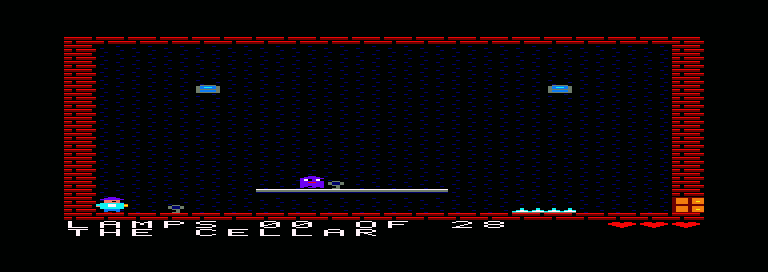

# Build Lamplighter: a CPCBuild tutorial

You are going to build a complete flip-screen platformer for the Amstrad CPC 464, one chapter at a
time, using Boriel BASIC and the CPCBuild tools in VS Code. At the end you will have a game you can
play on a CPC 464 or 6128, a Spectrum 48K or 128K, and (optionally) a CPC Plus.

> **Status: second draft.** The game and the library are finished and tested. The text was checked
> against the real Studio and Emulator extensions' source, their command titles, menus and settings, and
> screenshots of the running editors. Places that still need a pair of eyes or ears in a live VS Code session
> (the sound, a Spectrum emulator, the Plus cartridge through Studio, Tiled's own screens) are marked in the
> Markdown source with HTML comments that start with the word CHECK, each saying what to try.

## The game

**Lamplighter** climbs a dark tower at dusk. Every room has one to three unlit lamps. Touch a lamp
and it lights; light them all and the room's door opens. The tower has 12 rooms in a 3 x 4 grid
(28 lamps in all). You walk, jump, climb ladders and avoid spikes and three kinds of enemy. You
have three lives. Walk off the edge of a room and you flip to the next one.



The finished source is in [`games/lamplighter/`](../../games/lamplighter/). You write your own copy
as you go, and compare with it at the end of each chapter.

## Who this is for

You know some BASIC (Locomotive BASIC on the CPC, Sinclair BASIC on the Spectrum, or similar) and
you want to write a real game. You do not need to know Z80 assembly, Boriel BASIC, or the CPCBuild
tools. You write the whole game in plain BASIC; chapter 9 is where assembly appears, and it hands you each
routine ready to paste in, with a measurement for why.

## The chapters

| # | Chapter | You will | You will see |
|---|---|---|---|
| 1 | [A new project](01-new-project.md) | create a project from the template, build it, run it in the emulator tab | text bouncing on a CPC screen, and a Spectrum tape built from the same code |
| 2 | [Palette and tiles](02-palette-and-tiles.md) | bring in 16 pens and 16 tiles, draw one room with `TileMap` | the first room, in colour |
| 3 | [The tower](03-the-tower.md) | look at the 12-room map in Tiled and Studio's map viewer, cut it into rooms | all 12 rooms, flipping with two keys |
| 4 | [The player sprite](04-the-player-sprite.md) | draw a masked sprite, erase it with `TileRestore`, draw right after the flyback | the lamplighter walking about |
| 5 | [Movement](05-movement.md) | add gravity, a jump, one-way platforms and ladders | a player who falls, jumps and climbs between rooms |
| 6 | [Enemies](06-enemies.md) | add walkers, floaters and bats | things that move and want to hurt you |
| 7 | [Lamps, doors, lives and the HUD](07-lamps-doors-lives-hud.md) | make it a game: lamps, doors, lives, title, win and game over | the whole game, silent |
| 8 | [Sound and music](08-sound-and-music.md) | add a tune and effects through `lib/music` | music and a jump sound |
| 9 | [Measuring](09-measuring.md) | read the build report, run the bench on your all-BASIC game, then add six assembly routines one at a time | numbers, and what each routine bought |
| 10 | [The Spectrum build](10-the-spectrum-build.md) | build the same game for the Spectrum 48K and 128K | two `.tap` files |
| 11 | [The 6128 and the Plus](11-6128-and-plus.md) (optional) | build for the 6128, then the CPC Plus with hardware sprites and flickering flames | a Plus cartridge |

Chapters 1 to 9 build up one program. Chapters 10 and 11 are separate builds of the same game and
can be done in either order, or skipped.

## What you need

| You need | For | Check with |
|---|---|---|
| VS Code | everything | |
| The **CPC Game Studio** extension (`cpcbuild.cpcbuild-studio`) | editors, importer, build and run | the **CPC Game Studio** icon in the Activity Bar, once a folder with a `cpcbuild.json` is open |
| The **CPC Game Studio Emulator** extension (`cpcbuild.cpcbuild-emu`) | running the game in an editor tab | **CPC Emulator: Open File...** in the Command Palette |
| The Boriel BASIC compiler with the CPC backend, with `mkdsk` (the disc packager) | compiling and making `.dsk` files | **CPC Game Studio: Check Environment** (chapter 1) |
| The Lamplighter files: the finished game, the art files and `split_rooms.py` | comparing with your own copy, and the files you copy in | `games/lamplighter/` exists |
| [Tiled](https://www.mapeditor.org/) (chapter 3) | editing the tower map | **CPC Game Studio: Open in Tiled** |
| Python 3 (chapter 3, step 5 only) | running `split_rooms.py`, which cuts the map into rooms | `python3 --version` on macOS and Linux, `py -3 --version` on Windows |

You do not need Python for anything else (on a Mac, do not install Apple's developer tools just for it). Python is only for chapter 3, step 5, and you can skip it: that
step also says how to copy the finished `rooms.bas` instead. Tiled is optional too: you can follow chapter 3
without editing, because the finished map is in the repository.

The cpcbuild library (`lib/`) and the converters are bundled inside the Studio extension, including the Plus
sprite manager and palette cycling that chapter 11 uses, so no setting is needed for them.

### Installing the tools

The two extensions and the compiler are on the
[Releases page](https://github.com/carcharo/cpcbuild/releases) of `carcharo/cpcbuild`. There are two ways to get them. Chapter 1 walks through the first.

- **The two extensions.** Download `cpcbuild-studio-0.1.2.vsix` and `cpcbuild-emu-0.1.2.vsix`. In VS Code, run
  **Extensions: Install from VSIX...** from the Command Palette, once for each file. Then let Studio fetch the
  compiler with **CPC Game Studio: Download Tools** (chapter 1, step 2). For the Lamplighter files, clone or download
  the [cpcbuild repository](https://github.com/carcharo/cpcbuild) and look in `games/lamplighter/`.
- **The SDK folder.** Download `cpcbuild-sdk-0.1.2-<platform>.zip` (on Linux, the `.tar.gz`) for your system. It
  holds the compiler, both `.vsix` files and `games/lamplighter/`. See the
  [README](../../README.md#install) for the platform names and the notes for each system.

If you use the SDK, the Lamplighter files are in its `games/lamplighter/` folder. The SDK does not include the
repository's `tools/` folder, so for `split_rooms.py` in chapter 3 you need the repository (or you copy the
finished `rooms.bas`).

## How the chapters work

Each chapter has the same parts:

- **Goal** and **What you'll learn**.
- **Steps**: things you do, with the exact command or editor, and the code to write.
- **Build and run**: a checkpoint. It says what you should see in the emulator tab.
- **How it works**: the library calls used, explained, with the section of
  [`docs/library.md`](../library.md) where they are documented (by name: look for it in the
  Contents or search the file).
- **Try this**: small exercises.

Conventions:

- **`file:line`** after a code block, for example `game.bas:413-431`, means "this comes from the
  finished game's file, at those lines". Line numbers refer to the files in
  `games/lamplighter/` on the `platformer` branch.
- Code marked **(simplified)** is a cut-down version of the real thing. The text says what was left out.
- Commands in the Command Palette (press `Ctrl+Shift+P`, or `Cmd+Shift+P` on a Mac) are written
  with the exact title, for example **CPC Game Studio: Build and Run**.
- Other VS Code shortcuts are given for Windows and Linux (`Ctrl+S`). On macOS use `Cmd` in place of `Ctrl`
  (`Cmd+S`).
- Commands you type in a terminal are for macOS and Linux (`python3 ...`). On Windows the Python launcher is
  `py -3`. Lines that need a cpcbuild checkout and a Unix shell (`make`, `build_*.sh`, `bench.sh`) are marked
  as such, and the tutorial never needs them.
- Boriel BASIC variable names are case-insensitive; the game uses a mixture. Copy what you see.

### Where your files go

You will make one project folder, `lamplighter/`, laid out exactly like `games/lamplighter/` (a flat layout):

```
lamplighter/
  cpcbuild.json              the project: targets and asset recipes
  main.bas                   ties the layers together
  game.bas                   the rules: no drawing, no keys, no sound
  platform_cpc.bas           everything CPC-specific: screen, sprites, keys, sound
  platform_zx.bas            the Spectrum layer (chapter 10)
  platform_plus.bas          the Plus layer (chapter 11)
  assets/                    art, recipes and generated .bas files, side by side
    lamp.cpcpal  tiles.png  tiles.cpcimp  tiles.bas  ...
    zx/  plus/
```

On Windows, keep the project folder on a local drive such as `C:\`. VS Code refuses the `\\Mac\...` network
paths through which a Windows virtual machine sees its host's folders ("UNC host 'mac' access is not allowed").

The Studio's **New Project** template puts the `.bas` files in a `src/` folder instead; chapter 1, step 5
moves them to the root. Everything after that has the same paths as the finished game, so
`#include "assets/tiles.bas"` reads the same in your code and in `games/lamplighter/`. The generated
`.bas` files sit in `assets/` next to their `.png` and `.cpcimp`, as in the finished game.

### The art and data files you copy

Lamplighter's pictures were made by a Python script (`games/lamplighter/assets/make_art.py`) as PNG
files, so the tutorial starts from those PNGs rather than asking you to be an artist. You can also
draw everything in the Studio's editors; each chapter says how.

| Copy from `games/lamplighter/assets/` | Into (the same name) | Used in |
|---|---|---|
| `lamp.cpcpal`, `tiles.png`, `sprites.png` | `assets/` | chapters 2, 4 |
| `tower.tmx` | `assets/` | chapter 3 |
| `fontcpc.bas` | `assets/` | chapter 3 |
| `title.bas`, `gamesong.bas`, `sfx.bas`, `quiet.bas` | `assets/` | chapter 8 |
| `zx/zx_tiles.png`, `zx/zx_sprites.png`, `zx/sfx_zx.bas` | `assets/zx/` | chapter 10 |
| `plus/plus_tiles.png`, `plus/plus_sprites.png`, `plus/pl_pens.bas` | `assets/plus/` | chapter 11 |

`lamp.cpcpal` is a plain text file (a list of 16 firmware colours); Studio's palette editor opens it.

### What Studio does not do for this game

Studio runs the build, the editors, the importer, the map viewer and the emulator. The finished game
still uses a few things that Studio does not do; the tutorial says so in the chapter where each one comes up:

- **Drawing the art.** `assets/make_art.py` draws the PNGs, `lamp.cpcpal` and `tower.tmx`;
  `assets/make_plus_art.py` draws the Plus PNGs and writes `plus/pl_pens.bas` (a 12-bit pen table that has
  no recipe). The tutorial hands you the finished files (chapters 2, 3, 10, 11).
- **Splitting the map into rooms.** `assets/split_rooms.py` cuts `tower.tmx` into `rooms.bas`. Studio only
  converts a whole tile layer; the split is a small Python command you run yourself (chapter 3).
- **Packaging a disc.** Studio uses `mkdsk`, which comes with the compiler (Download Tools, or the SDK's
  `bin/`). It is licensed AGPL with the compiler, so it is not inside the extension.
- **The Plus loader disc.** `lampplus.dsk`, started with `RUN"PLUS`, comes from `build_plus.sh`; Studio's
  Plus target makes the cartridge only (chapter 11).
- **Size-limit checks.** `build_cpc.sh` stops if the program ends above `&8B60`, and `build_zx.sh` if the
  Spectrum image ends above `&F000`. Studio prints a report for CPC targets and a one-line size for tapes,
  but does not stop the build (chapters 9 and 10).
- **Tests.** The logic checks, the playthrough, the screenshot goldens and the benchmark are scripts and
  Makefile targets in the cpcbuild repository (`make test-lamp`, `make test-lamp-plus`, chapter 9).

Two Studio rules to know. First, Studio only acts in a folder that contains a `cpcbuild.json`: its
right-click menu entries (Import Image, Convert Tiled Map to BASIC, Run in Emulator, Convert and Play Music...)
appear only there. Second, a folder you cloned or opened for the first time is in VS Code's Restricted Mode,
where Build, Run and asset generation refuse until you trust the workspace (chapter 1).

### If something does not build

1. Run **CPC Game Studio: Check Environment**. It lists what it found and what is missing.
2. Open **View > Output** and choose **CPC Game Studio** in the drop-down: the compiler's messages are there.
3. Open the **Problems** panel: compiler errors and warnings appear there with file and line.
4. Compare your file with the finished one in `games/lamplighter/`.
